# POSH collection and audience architecture

## Vision

An owned customer history that tells us which upcoming events fit each person, explains the evidence, and prepares relevant outreach. A purchase is a preference signal, not proof of attendance or the reason someone attended. Account access limits the data available: this does not collect every POSH customer or other organizers' private data.

## Implemented flow

```mermaid
flowchart LR
  A[Owner signs into embedded browser] --> B[Persistent Playwright profile]
  B --> C[Daily event discovery and order collection]
  C --> D[Completeness checks and staged review]
  D --> E[Transactional SQLite reconciliation]
  E --> F[Customer history and event metadata]
  F --> G[Explainable audience scores]
  G --> H[Consent-filtered campaign drafts]
  H -. future integration .-> I[Email / SMS providers]
```

One server owns one browser profile, one queue at a time, and one SQLite database. Collection and the existing CSV worker share the browser lock. Browser sessions persist on disk; expired login or verification requires the owner to reconnect through Browser worker. No CAPTCHA or MFA bypass. Interactive sessions take precedence; closing the browser lets queued collection proceed. A 15-minute idle timeout closes unattended interactive sessions.

The reference automation in [Marcos-90-automations](https://github.com/Jojo42011/Marcos-90-automations/tree/master) informed session reuse, serialized actions, and avoiding blind replay of uncertain browser actions. No reference implementation was copied.

## POSH calibration — required before live use

The collection engine is tested against a local organizer dashboard. **Live POSH endpoint shapes, selectors, pagination, field availability, and account scope are not yet verified.** There are no guessed POSH endpoint defaults.

1. Sign in with the embedded Browser worker. Credentials stay in the browser profile or optional encrypted vault, never in a mapping or Git.
2. Observe actual authenticated dashboard responses. Identify current and past event lists, their full totals, and each event's order list. Confirm that cancelled/refunded records are included and filters do not hide history.
3. Configure URLs, CSS selectors, response URL, array path, total path, and field paths. The adapter observes GET JSON responses from real navigation and Next clicks. A POST/GraphQL or different pagination contract requires an adapter change and fixture tests. Do not replay arbitrary internal endpoints.
4. Use `docs/collector-config.example.json` as a **fictional mapping template**, replacing all URLs, paths and selectors. Configure disjoint current/past views. If the account exposes a combined all-events view, use that single view.
5. Link previously imported local events with `event_links: {"source-event-id":"local-event-uuid"}` before first import, so CSV and collected orders reconcile to the same IDs.
6. Close the interactive browser, run Collect now, and inspect the review. Compare counts, sample records and monetary totals against POSH, including old events, refunds, group tickets and free registrations.
7. Import the first verified run. Only then enable `auto_import` and `enabled` with `interval_minutes: 1440`. Any mapping change invalidates approval and requires another review.

The mapping must supply normalized types: money in integer USD cents; ISO timestamps with offsets; numeric counts; explicit status values. There is deliberately no generic JavaScript transformation field. Add a tested source transform if observed POSH values differ. Event capacity and base price are currently required; do not fabricate values if unavailable—extend the event schema to represent unknown values first.

## Data contract

| Record | Data |
| --- | --- |
| Event | Stable source ID, name, date/timezone, city, venue, status, capacity, base price; optional series, genre, artists, tags, format and description |
| Order | Stable source/event IDs, buyer email/name, quantity, subtotal/refund cents, currency, status and purchase date; optional source customer ID, phone, city, tracking channel/link and order scan count |
| Provenance | Organization, source ID, source updated time (or observation time), latest sanitized raw record, normalized record and run history |
| Consent | Separate per-channel decision and evidence, recorded through existing customer profiles; purchase/contact details never grant marketing permission |
| Campaign | Draft content, score/model version, frozen recipient reasons, holdout allocation; current eligibility is rechecked when viewed |

Source status mapping supports paid, free RSVP, refunded, cancelled, pending, denied, and transferred. Transfers are retained as source evidence but not new sales. A transfer that changes an existing sale stops reconciliation for explicit review. Ticket-level named attendees and transfer ownership are not modeled yet. Missing buyer email fails validation rather than inventing or incorrectly merging a person.

All pages must match a stable reported total, with no duplicate IDs. Failure leaves live data unchanged. Runs have a 15-minute deadline and limits of 5,000 events, 100,000 orders, 500 pages per view, 4 MB per response and 40 MB per staged snapshot. One pending review blocks subsequent runs. Missed schedule intervals coalesce; restart interrupts in-flight work, and queued work remains queued. Scheduled collection currently rescans configured history, rather than assuming POSH supports incremental cursors.

Repeated imports update orders instead of adding duplicate sales. Older source versions cannot overwrite newer versions; conflicting equal timestamps and identity changes roll back the entire run. Without source updated timestamps, observation order is the fallback and cannot detect upstream stale caches. Missing source records do not delete existing orders. Once collector-managed, an order cannot be overwritten by unversioned CSV imports. Existing profile name/city/phone are not silently overwritten.

## Matching v2

Scores are relevance scores, not calibrated purchase probabilities:

- Up to 40 points: matching genre, tags, artists and format.
- Up to 25: prior event series.
- Up to 20: recorded home city or previous event city.
- Up to 15: recency and repeat purchases across distinct events.

Historical signals decay with a 180-day half-life. Only past events with positive-net paid orders contribute; multiple tickets/orders for the same event count once. Cancelled events, free RSVPs and fully refunded purchases do not establish paid preference. Existing paid, RSVP and pending registrations for the target event are suppressed.

Confidence reflects distinct historical events: low under two, moderate two–four, high five or more. With at least three events, median purchase lead time is shown as descriptive timing evidence. It does not yet schedule sends. Matching cannot determine someone's true motivation; optional preference surveys can later add explicit reasons.

## Outreach boundary and next implementation

Campaign drafts are usable now. They select only channel-permitted contacts, retain model explanations, assign a default 10% holdout, and recheck consent, registrations and a two-sends-per-seven-days ceiling. **No provider is connected and no messages are sent.** Holdouts are assigned but lift/conversion reports are not yet implemented.

Next: configure an email provider (SMTP plus delivery callbacks) and SMS provider; add an approval screen, fresh registration-sync gate, transactional outbox, provider idempotency/reconciliation, unsubscribe/STOP handling, signed delivery callbacks, bounce/complaint suppression, send windows, and measurement against holdouts. Plain SMTP alone cannot guarantee replay-safe delivery after an uncertain timeout. These need provider-specific validation before enabling sends.

Before production: validate POSH calibration with the owner, back up SQLite and the encrypted browser volume, define retention/deletion for source data, and verify the browser sandbox works on the deployment host. Keep one app instance; multi-instance scheduling requires a shared queue/database and explicit leases.

## Verification

`npm test` covers API isolation, collector pagination in real Chromium, persisted login, first-run review, automatic reconciliation, refunds, duplicate/stale records, identity rollback, consent, registration suppression and campaign draft eligibility. `npm run build` and `npx playwright test` verify the UI including mobile layout and draft creation. The fixture tests establish engine behavior, not live POSH compatibility.
